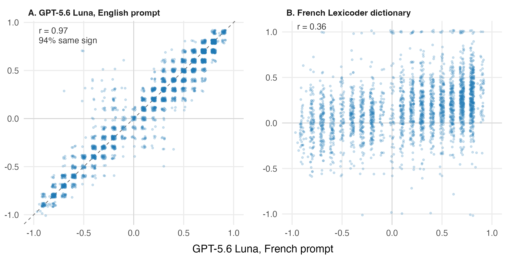
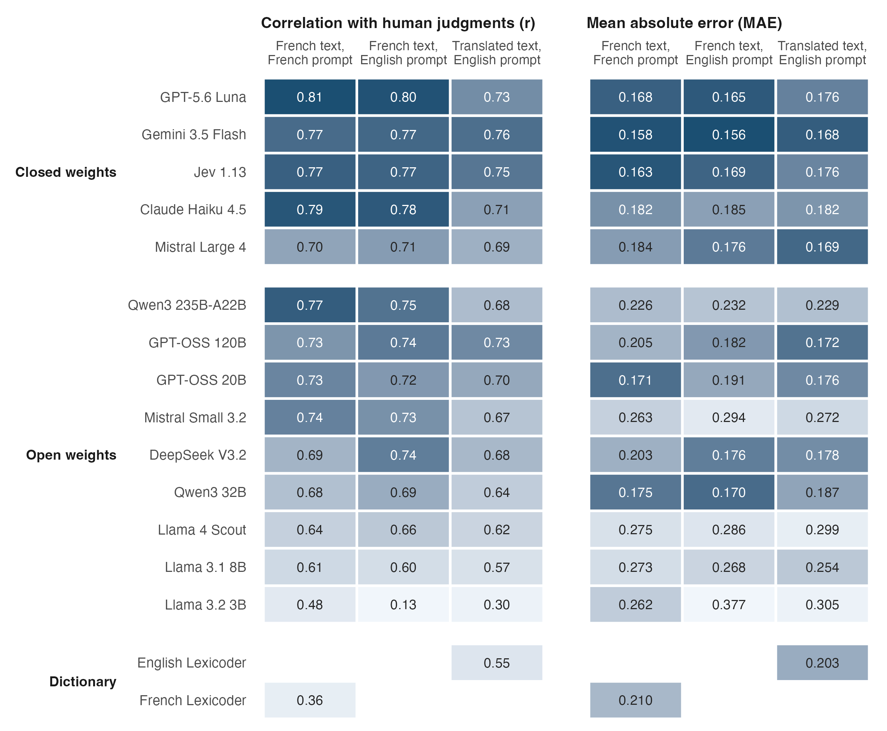
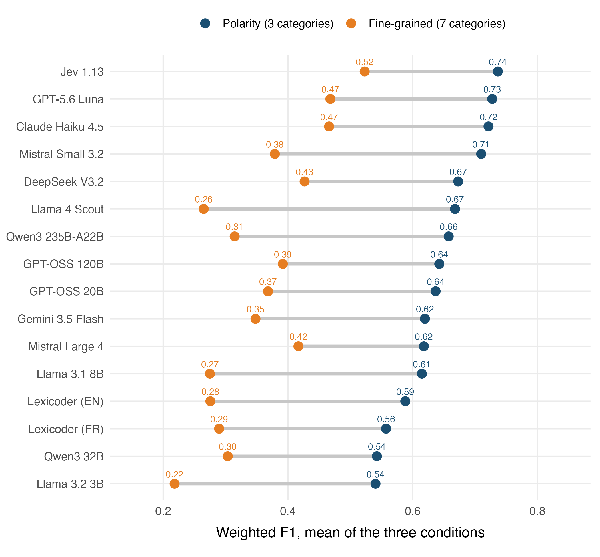

# Introduction

For ten years, the most common advice to a researcher facing a corpus in French, German, or Arabic was simple: translate it into English and use the English tools. Computational text analysis grew up around English, and its tools, from sentiment dictionaries to topic models, were built for English text. This dominance has been criticized for depressing comparative research and for excluding scholarly communities that work in other languages [@badenThreeGapsComputational2022]. Machine translation was the workaround, and it was validated repeatedly for dictionaries and topic models [@lucasComputerAssistedTextAnalysis2015; @devriesNoLongerLost2018]. Large language models (LLMs) change the terms of the problem. Used without task-specific training, they match or exceed crowd workers and expert coders on common annotation tasks [@gilardiChatGPTOutperformsCrowd2023; @tornbergLargeLanguageModels2025], and they do so, with some loss, in languages other than English [@heseltineLargeLanguageModels2024; @rathjeGPTEffectiveTool2024]. For the many researchers who work in a language other than English and have neither the labeled data nor the skills to train or fine-tune a model, this is the first tool that reads their texts as they are. This article shows that the old advice now points the wrong way.

Yet researchers who use LLMs on non-English text often keep two reflexes from the English-centered era. The first is to prompt in English. The justification is that these models are trained mostly on English [@touvron_etal23a] and that English instructions have been found to work better even for non-English inputs [@laiChatGPTEnglishComprehensive2023; @Lin2022Few]. English prompts are also cheaper, because tokenizers trained on English-heavy data split French into more pieces [@ahiaAllLanguagesCost2023]. The second is to translate the text into English before analysis. This practice comes from dictionaries and other bag-of-words methods, whose lexicons were English, and it reappears as "translate-test" with LLMs [@Etxaniz2024Multilingual]. Whether either reflex helps, harms, or makes no difference is unsettled, and the social science evidence is thin.

This article tests both reflexes on sentiment analysis, a measurement task central to political communication research [@young_andsoroka12; @vanAtteveldt2021validity]. Sentiment is a demanding test for translation, because affective meaning is precisely what translation can alter [@Mohammad2016translation]. The benchmark is a set of 200 sentences drawn from 2,683 articles on open-source software published by 13 French-language dailies in Québec and France, each sentence scored by three human coders. Fifteen open- and closed-weight language models scored them with a French prompt, with an English prompt, and with an English prompt on a machine translation. The French and English Lexicoder dictionaries provide the comparison that most applied researchers face. Equivalence tests establish the absence of a prompt-language effect as a finding rather than a non-result, and the best model then rescored the full corpus of 2,683 articles to check that the result holds at scale.

The results speak to both reflexes. Prompt language made no meaningful difference, though the English prompt is cheaper. The language of the text mattered only through the translator: Google Translate lifted the dictionary workflow from r = 0.36 to 0.55 but lowered every model of at least 8B parameters when the English prompt was held constant, whereas a translation by a frontier LLM recovered most of that loss but, on average, did no better than the original. The original text is also the cheapest input, since a model that translates must write every sentence out, whereas a model that scores returns a single number. The article also answers the practical question that follows: is a researcher working on French text still better served by a dictionary? On this evidence, no. Every model from about 8B parameters upward outperformed both the native French dictionary and the translated English one on correlation with human judgments, open-weight models included, for a few cents per thousand sentences.

# Literature Review

## LLMs as Measurement Instruments in the Social Sciences

Zero-shot LLM annotation has moved quickly from curiosity to candidate standard. The paper that set the agenda had ChatGPT annotate 6,183 English tweets and news articles without any example. Its accuracy exceeded that of crowd workers by about 25 percentage points on average, its intercoder agreement exceeded that of both crowd workers and trained annotators on every task, and each annotation cost about thirty times less than paying a crowd worker [@gilardiChatGPTOutperformsCrowd2023]. GPT-4 outperformed expert coders and supervised classifiers at identifying the party of politicians from their social media posts in eleven countries [@tornbergLargeLanguageModels2025]. GPT-4 also closely approximated expert coding of negativity and sentiment in tweets from the United States, Chile, Germany, and Italy [@heseltineLargeLanguageModels2024]. These results have fed broad claims that generative AI could transform computational social science [@ziemsCanLargeLanguage2024], chiefly by removing the need for the thousands of annotated examples that supervised learning requires [@laurerLessAnnotatingMore2024].

A more cautious literature qualifies these claims on three fronts. First, performance is uneven. Across 25 English benchmarks, zero-shot LLMs did not outperform the best fine-tuned models on classification tasks [@ziemsCanLargeLanguage2024]. When GPT-4 replicated 27 annotation tasks from 11 datasets in published social science articles, its performance varied with the dataset and with the kind of task, and on a third of the tasks the model missed or mislabeled at least half of the relevant cases [@pangakisAutomatedAnnotationGenerative2023]. Validation against human coding therefore remains indispensable [@grimmer_stewart13; @linNavigatingRisksUsing2026], and it is only as informative as the human gold standard is reliable [@songValidationsWeTrust2020]. Second, established tools retain advantages. Dictionaries generalize across domains and preserve gradations of sentiment [@vanderveenAdvantagesLexiconbasedSentiment2025]. However, off-the-shelf dictionaries validate poorly against human judgment [@vanAtteveldt2021validity], and transformer-based models outperform them in German political and cultural texts [@widmannCreatingComparingDictionary2023; @klahnDictionariesLLMsEvaluation2025]. A domain-specific multilingual classifier can also match GPT-4o at a fraction of the cost [@mochtakParlasentMappingSentiment2025]. Third, reliance on proprietary models threatens reproducibility [@spirlingWhyOpensourceGenerative2023]. This has prompted calls to justify their use [@palmerUsingProprietaryLanguage2023] and evidence that open-weight models can be competitive alternatives [@klahnDictionariesLLMsEvaluation2025].

These debates leave the question of language largely implicit. The broadest evaluations rely on English benchmarks [@ziemsCanLargeLanguage2024]. Studies that extend to other languages report slightly lower performance on non-English text [@heseltineLargeLanguageModels2024], or lower accuracy outside the United States that the authors attribute to party systems rather than to language [@tornbergLargeLanguageModels2025]. Neither examines how researchers should interact with models in those languages. The most extensive multilingual evaluation in the social sciences covers 12 languages, yet it compared GPT with dictionary methods on English headlines only [@rathjeGPTEffectiveTool2024]. Researchers working in other languages must make two choices: the language of the prompt and the language of the text.

## The Language of the Prompt

The case for prompting in English starts from two observations. LLMs are trained predominantly on English [@touvron_etal23a], and they perform less well in other languages, especially lower-resourced ones [@laiChatGPTEnglishComprehensive2023; @ahujaMEGAMultilingualEvaluation2023]. A mechanistic account suggests why. Llama-2 models seem to think in English before answering in another language. Given a French prompt, the model works out the meaning in its middle layers, and at that stage its internal state already points to the English word for the answer. Only in the last layers does it switch to the target language [@wendler_etal24]. If models effectively reason through English, instructions written in English should be understood best. Several findings support this pivot-language view. ChatGPT performed better with English prompts even when the task and input were in other languages [@laiChatGPTEnglishComprehensive2023]. English templates remedied the unexpectedly low accuracy of prompts handcrafted by native speakers [@Lin2022Few]. Models fine-tuned on English prompts performed best with English prompts even on non-English samples [@Muennighoff2023Crosslingual]. English instructions outperformed Arabic ones on average across eleven Arabic classification tasks [@Kmainasi2025Native].

A competing view emphasizes multilingual competence. Large models show strong multilingual reasoning abilities even in underrepresented languages [@shiLanguageModelsAre2022]. For capable models, the language of the prompt appears to matter little. In the Arabic study just cited, differences across prompt languages were minimal for the strongest model, GPT-4o [@Kmainasi2025Native]. GPT-4 Turbo's labels for Indonesian tweets under English and Indonesian prompts agreed almost perfectly [@rathjeGPTEffectiveTool2024]. The evidence on both sides comes mostly from reasoning and classification benchmarks, older models, and lower-resourced languages. None of it tests whether prompt language affects the accuracy of a graded sentiment judgment in a well-resourced language. The two views imply competing expectations:

> **H1a (pivot language).** English prompts yield more accurate sentiment measurement of French text than French prompts.
>
> **H1b (multilingual competence).** English and French prompts yield equivalent performance on French text.

## The Language of the Text

The second reflex predates LLMs. The bridge strategy of translating multilingual corpora into English so that English-language tools can be applied [@lucasComputerAssistedTextAnalysis2015] has been validated repeatedly. Machine-translated and human-translated texts yield highly similar term-document matrices and topic models [@devriesNoLongerLost2018]. A machine translation of the Lexicoder dictionary captured legislative conflict across European parliaments [@prokschMultilingualSentimentAnalysis2019]. For sentiment specifically, analysis of English translations of Arabic posts was competitive with analysis of the originals [@Mohammad2016translation]. The logic has carried into the LLM era. Translating inputs into English before inference improves the performance of multilingual models [@Etxaniz2024Multilingual]. It is often hard to beat for lower-resourced languages written in non-Latin scripts [@ahujaMEGAMultilingualEvaluation2023].

The opposing view treats translation as a source of loss. Translation alters sentiment: affective words disappear or are replaced by words of opposite valence, ambiguous words are mistranslated, and culturally specific expressions lose their meaning [@Mohammad2016translation]. Approaches that avoid translation, such as multilingual sentence embeddings, yield comparable or more reliable results in some settings [@lichtCrossLingualClassificationPolitical2023]. Crucially, the case for translation was built largely on tools that cannot read the source language, such as English dictionaries and bag-of-words models. LLMs can. In NLP, a large multilingual model already performed better on the original than on an English pre-translation in 94 of 108 languages [@intratorBreakingLanguageBarrier2024]. For LLMs, the supporting evidence comes from benchmarks whose non-English versions were themselves created by translation, a setting that may favor translation-based methods, as the authors note [@Etxaniz2024Multilingual]. It does not come from text written natively in the source language. Again, the two views imply competing expectations:

> **H2a (translation as bridge).** Analyzing English machine translations yields sentiment measurement at least as accurate as analyzing the French original.
>
> **H2b (translation as loss).** Analyzing English machine translations yields less accurate sentiment measurement than analyzing the French original.

## Research Questions

These debates motivate two research questions. **RQ1:** Does the language used to interact with the model affect LLM sentiment measurement of French text? This covers the language of the prompt and the language of the text through machine translation. H1a–b and H2a–b offer competing answers. **RQ2:** Can general-purpose LLMs, open- and closed-weight,^["Open source" traditionally implies access aligned with free and open-source software principles. In the LLM context, the term usually refers to the public release of model weights. "Open-weight" describes this condition more accurately and is used throughout.] measure sentiment in French text well enough, without fine-tuning, to be a viable alternative to dictionary-based methods?

# Data & Methods

## Data Collection and Preparation

The corpus consists of 2,683 French-language news articles from 13 media sources (9 from Québec, 1 from Ontario, 3 from France). It is an exhaustive collection of the articles discussing open-source software in the Eureka database's "Major daily newspapers (FR)" category. Articles were selected with twelve French and English terms for free and open-source software, such as *logiciel libre* and *open source*, joined by OR, between January 1, 1991 and January 1, 2025. The start date is the release year of the Linux kernel, the project that made open-source software a public topic, so the window covers the entire history of the subject in the press. In practice it excludes nothing: the earliest match dates from June 1995.

The three French national dailies account for 68% of the articles. Articles were downloaded in HTML format with a Python/Selenium scraper, and publication metadata and full text were extracted with custom R functions.

## Translation

The EN→EN condition described below reproduces the translate-then-analyze strategy reviewed above. For this condition, the French corpus was machine-translated into English with Google Translate's document translation service. An automated R workflow processed the documents in batches and preserved document IDs, so that the French and English versions remain aligned.^[See `src/21_translate_to_english.R` in the project repository.]

## Manual Annotation

A validation benchmark of 200 sentences was randomly sampled from the corpus. The sentences come from 194 different articles (six articles contribute two) and average 23 words (median 21, range 1 to 73). Each sentence was machine-translated into English with Google Translate through the `polyglotR` package. This sample size falls within the 100 to 300 units generally recommended for validating automated sentiment measures against a manually coded gold standard [@vanAtteveldt2021validity, p. 135]. It yields 95% confidence intervals of roughly ±0.05 around a correlation of 0.80. Three members of the research team, all native French speakers, rated the sentiment of each sentence independently, on a scale from -1 (very negative) to 1 (very positive), in a custom Shiny application that displayed the sentence and its English translation and no model output. The three ratings were averaged. This average is the ground truth against which both dictionary and LLM methods are evaluated.

Agreement between individual coders was moderate. Krippendorff's alpha (interval) was 0.597 (95% bootstrap CI [0.516, 0.656]). The mean pairwise correlation between coders was 0.687. All three coders assigned the same sign (negative, zero, or positive) to only 42.5% of sentences. Two features of the task account for much of this disagreement. Coders used a fine-grained scale with more than 60 distinct values, and most sentences carry mild sentiment, so small differences often cross zero. The ground truth averages three coders and is therefore more reliable than any single coder: the Spearman-Brown projection from the mean pairwise correlation puts the reliability of the three-coder mean at 0.868. The disagreement also bounds what any method can achieve against a single coder: the scores of the best model, GPT-5.6 Luna with French prompts, correlated with each coder at 0.70 to 0.77 (mean 0.73), slightly above the correlations between coders (0.64 to 0.72, mean 0.69).

## Dictionary-Based Sentiment Analysis

Lexicon-based scoring was applied to the French original and to the English translation as a classical baseline. For French text, the French Lexicoder Sentiment Dictionary [@duval_petry16] was loaded as a quanteda dictionary without any change to its word lists and applied to lowercased, stopword-removed, sentence-segmented text, without negation handling.^[Removing stopwords prevents some multiword entries of the dictionary from matching. Scoring the same sentences without that step changes the score of 3 sentences out of 200 and the correlation with human judgments from 0.357 to 0.356.] Each sentence was scored as (positive terms − negative terms) / total words. For the English translation, the standard Lexicoder Sentiment Dictionary [@young_andsoroka12] was used, with additional handling of contractions, proper nouns, and negation (for example, "not good" scored as negative). Each sentence was scored as ((positive + negated negative) − (negative + negated positive)) / total words. The two dictionaries therefore differ in construction as well as in language, and the negation handling, available only for English, can only favor the English dictionary.

## LLM-Based Sentiment Analysis

Fifteen general-purpose language models were evaluated. They were selected for prominence and affordability, as realistic choices for researchers who need to analyze large corpora. Three closed-weight models from the major vendors are included as a reference point, the justification that @palmerUsingProprietaryLanguage2023 ask for: the studies that established LLM annotation in the social sciences relied on proprietary GPT models [@gilardiChatGPTOutperformsCrowd2023; @heseltineLargeLanguageModels2024; @rathjeGPTEffectiveTool2024; @tornbergLargeLanguageModels2025]. Two further models test a specific claim. Mistral AI, a French developer, describes its models as particularly strong in French and reports that its Tekken tokenizer compresses French text about 30% more efficiently than its earlier tokenizer [@mistralaiMistralNeMo2024]; two Mistral models test both claims.

The ten open-weight models are Llama 3.2 1B, Llama 3.2 3B, Llama 3.1 8B, GPT-OSS 20B, Mistral Small 3.2 24B, Qwen3 32B, Llama 4 Scout, GPT-OSS 120B, Qwen3 235B-A22B, and DeepSeek V3.2. They range from 1B to 671B total parameters. The five closed-weight models are Claude Haiku 4.5 (Anthropic), Gemini 3.5 Flash (Google), GPT-5.6 Luna (OpenAI), Mistral Large 4 (Mistral AI), and Jev 1.13 (TypeSafe). Mistral Large 4 was evaluated in its October 2026 preview release and is classified as closed-weight because its weights were not yet published. Jev is included because scoring by probabilities rather than by generated text is a different way of measuring a continuous construct. It is not a text generator: it answers a typed question with a probability for each possible answer. It received the same task as the other models, posed as a question whose five answer levels are the five anchors of the sentiment scale, worded as in the prompts below and in the language of each condition. Its score is the probability-weighted average of the five levels, mapped onto the -1 to 1 scale. This lineup updates an initial 2024-2025 evaluation of 11 comparable models with an identical design. The smallest model, Llama 3.2 1B, rarely followed the instruction to answer with a number: about one call in 23 returned a parseable score, and even after retries it scored only 58 to 74 of the 200 sentences, depending on the condition. It was retained to mark the lower end of the size range. Its answers were mostly sentences rather than numbers, so the parsing problem described below also affected it; its scores are reported only to show that a 1B model could not perform the task, and are not interpreted.

Each model was tested under three conditions: French prompts on French text (FR→FR), English prompts on French text (EN→FR), and English prompts on the machine-translated English text (EN→EN).

All prompts followed the same structure: a task definition, a five-point sentiment scale from -1.0 to 1.0 with anchor descriptions and intermediate values allowed, an instruction to consider cultural and linguistic nuance, and a constraint to respond with a numerical value only. The French prompts were translated from the English prompts by an LLM (Claude) and checked by the three coders, all native French speakers.^[The French-prompt/French-text version is identical except for language. In every condition, the prompt was preceded by the same one-sentence system prompt in English: "You are a helpful assistant that analyzes the sentiment of text. You provide accurate and consistent sentiment ratings according to the specified scale." See `src/93_prompts.R` in the project repository for the exact prompts, and `src/40_prompt.R` for the full evaluation pipeline, including model initialization, retry logic, rate limiting, and checkpointing.]

The generative models were queried through the `ellmer` R package. Claude Haiku 4.5, Gemini 3.5 Flash, and GPT-5.6 Luna were accessed through their vendors' APIs. The ten open-weight models and Mistral Large 4 were accessed through OpenRouter. Responses were capped at 400 tokens; no temperature or seed was set, so each provider's default sampling applied. OpenRouter can serve the same model through several providers at different numerical precisions. Each model accessed through OpenRouter was therefore pinned to a single named provider endpoint, at the highest precision offered, with fallback to other providers disabled.^[Endpoint pins (Mistral Large 4 is served only by Mistral itself), and the reasoning settings used to suppress chain-of-thought in models that reason by default, are listed in `src/94_models_map.R`. Mistral Large 4 reasons by default, exhausts the 400-token cap, and returns no answer. Its reasoning was disabled, as for Qwen3 32B and DeepSeek V3.2.] Gemini 3.5 Flash was queried with its default settings. Under these settings it generates reasoning tokens before answering: 354 output tokens per call on average, against 7 for Claude Haiku 4.5. Jev was queried through TypeSafe's API, with the model version pinned.^[See `src/42_jev_prompt.R` and `src/98_jev_helpers.R`.] Each sentence was scored three times per model and condition (27,000 scores in total), and the mean of the three runs was taken as the final score. The runs agreed closely: across the 42 model-condition combinations, the correlation between two runs of the same model had a median of 0.91, from 0.41 for Llama 3.2 3B to 0.97 for GPT-5.6 Luna and Qwen3 235B-A22B, and Jev, whose output is a probability distribution, was fully deterministic. Despite explicit instructions to respond with a bare number, some answers contained other text. A number was read from each answer with a pattern-matching function, and only values within the -1.0 to 1.0 range were retained. After data collection, this function was found to drop the minus sign when a number followed a label or formatting (for example, "Sentiment: -0.5" was read as 0.5). A diagnostic on 60 answers from each of the five models whose answer format could not be inferred from the token logs showed that four of them answered with a bare number or an empty answer, both handled correctly. Gemini 3.5 Flash occasionally hedged between two values, so its scores were collected again with a corrected function, which accepts an answer only if it contains a single number and keeps its sign.^[See `src/99x_parser_diagnostic.R`. The answers of the other generative models were 3 to 7 tokens long on nearly every call, the length of a bare number. The corrected function and an archive of every raw answer collected with it are in the repository.] Jev's answers needed no parsing.

To check whether the sentence-level findings hold at the scale of a real corpus, the best-performing model on the benchmark, GPT-5.6 Luna, also scored all 2,683 full articles under the FR→FR and EN→FR conditions, with the same prompts and settings, and Jev did the same, which gives the corpus check a second model of a different kind.^[See `src/70_prompt_corpus.R` and `src/72_jev_corpus.R`. The two GPT-5.6 Luna passes required 5,366 API calls, 7.1 million input tokens and 187,000 output tokens, for USD 1.64 at list prices.] These scores are compared with the French Lexicoder dictionary in the Results (@fig-corpus). A final check asks whether the translation condition measures the cost of translation or of the translator: the 200 sentences were translated again by GPT-5.6 Luna and rescored under the English prompt by the thirteen generative models, with the same parsing and averaging, in three runs for the three models accessed directly from their vendors and one run for the ten served through OpenRouter.^[See `src/43_llm_translation_test.R`. OpenRouter's shared provider pools throttled the check heavily, hence the single run; Qwen3 235B-A22B could not be held to its pinned provider and was served by another, and GPT-OSS 20B returned no parseable score for one sentence. Jev, whose input is a typed question rather than a text prompt, was not retested.]

## Validation and Performance Evaluation

Performance was assessed with four metrics: Pearson correlation between each model's continuous predictions and the ground truth; mean absolute error (MAE); weighted F1 on a 7-category classification, from "very negative" to "very positive", with cutpoints at −0.66, −0.33, 0.33 and 0.66 and exactly 0 as neutral; and weighted F1 on a 3-category classification (negative, neutral, positive) that groups the 7 categories into polarity bands. Weighted rather than macro F1 is used because the manually coded categories are unevenly distributed. "Somewhat positive" alone accounts for 44% of annotated sentences, while "very negative" and "very positive" each account for 1% or less. Comparing the two classification schemes separates fine-grained discrimination (7 categories) from polarity classification (3 categories). All metrics were calculated on complete cases only.

Condition comparisons are paired by model and map onto the hypotheses. The prompt-language hypotheses compare FR→FR with EN→FR, which hold the French text constant. The translation hypotheses compare EN→FR with EN→EN, which hold the English prompt constant and isolate the effect of analyzing the translation. The comparison of FR→FR with EN→EN contrasts the two complete workflows a researcher might adopt. A non-significant t-test cannot by itself establish the absence of an effect. Alongside paired t-tests, two one-sided tests (TOST) therefore assess whether a difference is small enough to be treated as negligible, with an equivalence bound of ±0.05 on each metric's scale [@lakensEquivalenceTestsPractical2017]. The bound is anchored in the study's own coders: the correlation between one coder and the mean of the other two ranges from 0.72 to 0.78, a spread of 0.055, and a difference between conditions smaller than the disagreement among the human coders is not one worth acting on.^[The verdicts are sensitive to the bound in the expected direction. At ±0.03, only the MAE contrasts and one F1 contrast remain equivalent; at ±0.10, every contrast becomes equivalent, including the translation contrasts that the paired t-tests find significant. The twelve tests are reported without correction for multiple comparisons, since each answers a distinct question.] These comparisons and the averages reported in the Results cover the thirteen models of about 8B parameters and more (39 model-condition combinations), the population the article's conclusions concern. They exclude the dictionary baselines, which have no prompt, Llama 3.2 1B, which could not perform the task, and Llama 3.2 3B, which is below that size and erratic; the tests with Llama 3.2 3B included are reported in notes.

# Results

## Prompt Language (H1a vs. H1b)

Holding the text constant, prompt language made no detectable difference (@fig-performance shows the three conditions for each model). Across the thirteen models of at least 8B parameters, French prompts on French text (FR→FR) and English prompts on the same text (EN→FR) gave nearly the same results: mean correlation 0.725 vs. 0.729, MAE 0.204 vs. 0.204, 3-category F1 0.679 vs. 0.669, and 7-category F1 0.390 vs. 0.378. None of these paired differences was statistically significant (all *p* > 0.10). Equivalence tests go further. FR→FR and EN→FR were statistically equivalent within ±0.05 on all four metrics (all *p* < 0.01). On correlation, the 90% confidence interval of the difference, [−0.014, 0.006], rules out an advantage larger than 0.014 for either prompt language.^[With Llama 3.2 3B included, equivalence could not be established on correlation: the 90% confidence interval of the difference was [−0.024, 0.066], driven by that model's erratic scores under the English prompt.] The results contradict H1a and support H1b.

The equivalence holds at the scale of the corpus. @fig-corpus plots, for each of the 2,671 full articles with all three scores, the score GPT-5.6 Luna gave under the English prompt against the score it gave under the French prompt (left), and the French Lexicoder score against the French-prompt score (right). The two prompt languages agree almost perfectly (r = 0.97; 94% of articles received the same sign), and Jev shows the same on the same articles (r = 0.997; 98% the same sign). The dictionary and the model rank the articles very differently (r = 0.36 across articles, 0.42 across monthly means), and on 28% of articles they disagree even on the sign.^[Correlation ignores differences of scale, so this is a disagreement about which articles are more positive than others, not about units.] The comparison cannot say which of the two is right, since neither is the ground truth; the benchmark results below can.

{#fig-corpus apa-note="Each cell covers a 0.1 by 0.1 range of scores and is shaded by the number of articles it contains (n = 2,671). The horizontal axis is the GPT-5.6 Luna score under the French prompt. Left: the same model's score under the English prompt, with the identity line dashed (r = 0.97; the two prompts give the same sign on 94% of articles). Right: the French Lexicoder score on the original text (r = 0.36; the dictionary and the model give the same sign on 66% of articles and opposite signs on 28%, the remainder being articles that one of the two scores exactly zero). All scores run from −1 (very negative) to 1 (very positive)."}

## Machine Translation (H2a vs. H2b)

For the LLMs, translation carried a cost. Holding the English prompt constant, analyzing the translation instead of the original (EN→EN vs. EN→FR) lowered mean correlation by 0.043 (0.687 vs. 0.729, *p* < 0.001) and 3-category F1 by 0.041 (0.629 vs. 0.669, *p* < 0.001).^[With Llama 3.2 3B included, the drop in correlation was smaller and not statistically significant (0.028, *p* = 0.12).] Differences in MAE and 7-category F1 remained within the ±0.05 equivalence bound. Compared with the fully French workflow (FR→FR), the fully English workflow (EN→EN) lowered correlation by 0.039 (*p* < 0.001) and 3-category F1 by 0.050 (*p* < 0.001).

Is this the cost of translation or of the translator? The sentences were translated again by GPT-5.6 Luna and scored under the English prompt by the twelve generative models of at least 8B parameters (@tbl-translator). Because most of these models scored the new translation only once, the comparison uses the first run of every condition. On correlation, the frontier-quality translation recovered most of the loss: the models averaged r = 0.697 on it, against 0.668 on the Google translation and 0.705 on the original. The remaining gap of 0.008 was not statistically significant (paired *p* = 0.48), and five of the twelve models scored higher on the LLM translation than on the original. On polarity classification the recovery was smaller: mean 3-category F1 was 0.627 on the original, 0.591 with Google Translate and 0.602 with the LLM translation, still below the original (*p* = 0.01). The loss observed in EN→EN is therefore mostly the cost of a conventional translator. A better translator removes most of it but, on average, does not do better than the original.

::: {#tbl-translator}



Table: Correlation and 3-Category F1 With Human Judgments Under the English Prompt, by Text Analyzed (French Original, Google Translation, GPT-5.6 Luna Translation); the Last Row Is the French Lexicoder on the Original and the English Lexicoder on Each Translation

:::

The dictionaries showed the opposite pattern. The English Lexicoder applied to the translation correlated with human judgments at r = 0.548, against 0.357 for the French Lexicoder applied to the original. The difference is 0.191 (95% bootstrap CI [0.059, 0.326]). The English dictionary also reached a higher 3-category F1 (0.588 vs. 0.557). With the LLM translation it rose further, to r = 0.574 and F1 = 0.597 (@tbl-translator): the better the translation, the more the dictionary gains, whereas the models at best recover the original. The two dictionaries also differ in construction, so this contrast does not isolate language. Its direction nonetheless matches the bridge view. For the LLMs, the results support H2b for a conventional machine translation: it lowered both correlation and polarity classification, whichever prompt was held constant. With a frontier-quality translation, the loss mostly disappears on correlation but does not reverse on average: H2a, which predicts a translation at least as accurate as the original, holds for five of twelve models on correlation and for one on polarity.

## Viability Against Dictionary Methods (RQ2)

General-purpose LLMs, used without fine-tuning, correlated with human judgments well above both dictionaries (@fig-performance). The best configuration, GPT-5.6 Luna with French prompts, reached r = 0.81. Jev came close behind the leaders, with r = 0.77 in both conditions on French text and the second-highest 7-category F1 (0.528 in EN→FR). Twelve of the 42 model-condition combinations correlated with the ground truth more strongly than individual human coders agreed with the mean of the other two (mean leave-one-out r = 0.748, range 0.724–0.779).^[This comparison slightly favors the models, because the ground truth they are compared against averages three coders rather than two. Agreement between annotators is not a strict ceiling on machine performance [@richieInterannotatorAgreementNot2022].]

{#fig-performance apa-note="One row per model and condition, sorted by each model's mean correlation and colored by model type. Left panel: Pearson correlation between the model's scores and the mean of three human coders, with 95% confidence intervals. Right panel: mean absolute error, the average distance between the model's score and the human score on the −1 to 1 scale, so that 0.17 means the model is typically 0.17 points away from the human rating. Within each model, the conditions are FR→FR (French prompt on French text), EN→FR (English prompt on French text), and EN→EN (English prompt on translated text). $^{*}p$ < .05, $^{**}p$ < .01, $^{***}p$ < .001."}

Closed-weight models outperformed open-weight ones on average (mean r = 0.754 vs. 0.646; 3-category F1 0.685 vs. 0.632). The gap closed at the top of the open-weight range. Qwen3 235B-A22B reached r = 0.77 in FR→FR, above Gemini 3.5 Flash in the same condition. GPT-OSS 120B and GPT-OSS 20B averaged r = 0.73 and 0.72 across conditions. Mistral Small 3.2 reached the highest 3-category F1 of any open-weight model (0.721 in FR→FR), although its scores sat further from the human ratings (MAE 0.263 to 0.294). Mistral's newest flagship did not lead its own family: Mistral Large 4 scored below Mistral Small 3.2 on correlation (r = 0.69 to 0.71) and 3-category F1 (0.61 to 0.62), though with a lower MAE. Performance degraded at smaller sizes. Llama 3.1 8B remained usable (r = 0.58 to 0.61). Llama 3.2 3B was erratic (r = 0.48 in FR→FR but 0.13 in EN→FR). Llama 3.2 1B could not perform the task: it returned a usable number on about one call in 23, and its few scores are not interpreted.

Cost was not a barrier. At list prices, scoring 1,000 sentences cost between USD 0.02 and 0.40 for every model but one. The exception, Gemini 3.5 Flash (USD 3.77), reflects the reasoning tokens it generates by default rather than its per-token price.^[No cost is reported for Llama 3.2 1B, whose endpoint returned the same input token count on every call; it also needed 22.7 API calls per usable score, against 1.0 to 1.03 for every other model.]

Against the LLM mean of r = 0.685, the dictionaries trailed on correlation (0.548 and 0.357) and on 3-category F1 (0.588 and 0.557 vs. 0.651). On correlation, the comparison is one-sided: every model from 8B parameters upward exceeded both dictionaries in every condition, and only Llama 3.2 3B fell below them. On 3-category F1, the translated English dictionary outperformed Qwen3 32B in every condition, GPT-OSS 120B in EN→EN, and the two smallest Llama models. On MAE, both dictionaries (0.203 and 0.210) did slightly better than the LLM average (0.211; @fig-performance, right panel), because their scores cluster near zero on a sample dominated by mildly positive sentences.

## Classification Granularity

All models performed substantially better on 3-category than on 7-category classification (best F1 0.778 vs. 0.537; mean 0.651 vs. 0.369; @fig-f1). Models identified positive and negative sentiment most reliably (7-category F1 = 0.480 and 0.454, rising to 0.706 and 0.626 in the 3-category scheme). They struggled most with the extreme categories (very negative F1 = 0.260, very positive F1 = 0.135), which are nearly absent from the sample (two sentences and one sentence). Neutral remained the hardest 3-category label (F1 = 0.272).

{#fig-f1 apa-note="One row per model, from the highest polarity F1 to the lowest, colored by model type. Filled circles are the weighted F1 on three categories, hollow circles on seven, each averaged over the three conditions; the segment is the loss from grouping sentiment into seven categories instead of three. Llama 3.2 1B is omitted."}

# Discussion

## Prompt Language: Multilingual Competence, Within Scope Conditions

For French and current models, the results side with the multilingual-competence view. English prompts brought no advantage, and equivalence tests ruled out any English-prompt gain larger than a few hundredths, even on correlation, where strict equivalence could not be established. The equivalence held at the scale of the full corpus (@fig-corpus). Earlier social science evidence showed that labels agree across prompt languages [@rathjeGPTEffectiveTool2024]. This study extends that finding to the accuracy of the labels against human judgment. It is also consistent with the minimal differences observed for the strongest model in Arabic [@Kmainasi2025Native]. The results do not refute the pivot-language evidence so much as delimit it. That evidence comes largely from reasoning and inference benchmarks, older or smaller models, and lower-resourced languages [@Lin2022Few; @Muennighoff2023Crosslingual; @laiChatGPTEnglishComprehensive2023]. The representational bias toward English that it points to [@wendler_etal24] need not produce worse instruction-following for a simple judgment in a language as well represented as French. The smaller open-weight models behaved differently. Llama 3.2 3B correlated with human judgments at r = 0.48 with French prompts but 0.13 with English ones. This suggests that sensitivity to prompt language may reappear below a certain model size, although a single model cannot establish this.

Prompt language does carry a cost that the accuracy results do not show. The French prompt is 6% longer than the English one in characters, yet it cost 10% to 34% more input tokens, depending on the model.^[Jev's input is TypeSafe's structured question rather than the prompt shown above, so its token counts do not measure the same text. It is left out of the tokenizer comparisons in this paragraph.] The difference is a property of each model's tokenizer, not of its size or license. Vocabularies that favor English encode English text with similar efficiency across models (1.17 to 1.25 tokens per word) but split French words into more pieces (1.38 to 1.87 tokens per word). @ahiaAllLanguagesCost2023 document the same disparity across many languages. Mistral's claim of a tokenizer that is cheaper on French [@mistralaiMistralNeMo2024] held for one of its two models. Mistral Large 4 encoded French more compactly than any other model and had the smallest French-prompt overhead (10%). Mistral Small 3.2 did not stand out (1.45 tokens per French word, a 15% overhead). Output length did not differ by prompt language. Since accuracy was equivalent, the English prompt is the cheaper of two equally good options. The saving per 1,000 sentences ranges from under 6% for models whose output tokens weigh most in the bill to 10% to 31% for models billed mostly on input. Translating the text first would save a few percent more, at the accuracy cost reported above.

## Translation: A Bridge for Dictionaries, a Cost Without Gain for LLMs

The translation results are the article's main contribution to the debate. The same machine translation that improved the dictionary lowered the LLMs' performance, and a better translation closed most of that gap without, on average, opening a lead. This reconciles the bridge and loss views rather than choosing between them. Translation helps tools that cannot read the source language, and the better the translation, the more it helps them; it is at best neutral for tools that can read the source, since a conventional machine translation costs them information and a frontier-quality translation returns, on average, about what the original already offered. The dictionary result is consistent with a long line of evidence that translating into English lets researchers use better-validated English resources [@devriesNoLongerLost2018; @prokschMultilingualSentimentAnalysis2019]. LLMs already read French. For them, translation offers no such gain. It exposes the analysis to the alterations of affective meaning that translation introduces [@Mohammad2016translation], and it adds a step that costs more than the scoring itself, since the model must write every sentence out in English before another call returns a single number. The same pattern appears, in passing, in the largest LLM study of party manifestos to date: inserting a machine-translation step before the analysis of 15 non-English manifestos lowered the correlation with expert surveys, and the authors dropped the step from their final design [@benoitUsingLargeLanguage2026]. The present study tests that observation directly, against human coding of text written in French, and sets it against the dictionary, for which translation helps. It agrees with NLP evidence that strong multilingual models do better on the original than on a pre-translation [@intratorBreakingLanguageBarrier2024]. The finding qualifies evidence that translating inputs into English improves multilingual models [@Etxaniz2024Multilingual]. That evidence comes from benchmarks translated out of English, whereas the sentences analyzed here were written in French. For an LLM, the original text is the cheapest and safest input.

## Viability: Optimism, With Validation

On RQ2, the results side with the optimistic literature [@gilardiChatGPTOutperformsCrowd2023; @tornbergLargeLanguageModels2025; @rathjeGPTEffectiveTool2024] and extend it in two directions. First, the advantage of LLMs over dictionaries holds against a native-language dictionary as well as a translated one. Second, open-weight models were viable from about 8B parameters, and the largest approached the best closed-weight models. This is consistent with evidence from German [@klahnDictionariesLLMsEvaluation2025]. Below that size, performance became erratic, and a 1B-parameter model could not follow the task. For researchers weighing the reproducibility concerns raised by proprietary models [@spirlingWhyOpensourceGenerative2023], this makes a credible open-weight option available at low cost. Qwen3 235B-A22B and GPT-OSS 120B reached 90–95% of the best closed-weight correlation for USD 0.02–0.03 per thousand sentences. Models from a French developer showed no French advantage. Neither Mistral model did notably better with French prompts, and both trailed the leading closed-weight models. A different kind of model also proved viable. Jev, which returns a probability for each point of the scale rather than generated text, came within 0.04 of the best correlation for about USD 0.02 per thousand sentences. For French text, the answer to RQ2 is therefore yes. A general-purpose LLM measures sentiment better than the Lexicoder dictionary on every criterion that rewards discrimination, and the cost of running one is no longer a reason to prefer the dictionary. This is the condition under which comparative research in a non-English language becomes cheap: no translation step, no training data, no fine-tuning, a validated model, and a prompt in whichever language the researcher writes most easily.

The cautious literature is not dismissed. Performance varied widely across models, which reinforces the need to validate each model on each task [@pangakisAutomatedAnnotationGenerative2023]. Two further results qualify the picture. First, the dictionaries' near-zero output gave them a slightly lower MAE than the LLMs. MAE alone can thus reward a method that barely discriminates. Second, all models performed markedly worse on 7-category classification than on 3-category polarity. The two results fit together once one separates ranking sentences from placing them on the scale. LLMs order sentences and reproduce the spread of human ratings. Their correlation with the ground truth far exceeds that of the dictionaries. From 8B parameters upward, their scores spread at least as widely as the human ratings (SD 0.30 to 0.49 vs. 0.286), whereas the dictionaries' scores cluster near zero (SD = 0.065 for the English dictionary). What LLMs do poorly is place scores on the right side of fixed category thresholds. They overstate extremes: 10.6% of LLM scores exceed ±0.66, against 1.5% of ground-truth values. A sentence rated 0.5 by humans and 0.8 by a model is correctly ordered but misclassified. The ground truth contributes to the mismatch, since averaging three coders pulls it toward the center. Gradations in sentiment are one of the main arguments for dictionaries [@vanderveenAdvantagesLexiconbasedSentiment2025]. In this corpus, a single off-the-shelf dictionary captured them less well than the LLMs. The gap does not close with aggregation: on the full corpus, the dictionary agreed only weakly with the model, by article and by month (@fig-corpus). What the dictionary retains is transparency, since every score can be traced to the words that produced it, and stability over time, since a dictionary is not deprecated. These make it a useful baseline and robustness check alongside an LLM. They are not a reason to prefer it as the primary measure.

# Limitations

Several limitations qualify these findings. The benchmark is modest in size and reliability. Its 200 sentences meet common size recommendations, but agreement between individual coders was moderate (Krippendorff's alpha = 0.597). Simulations show that such conditions raise the risk of misjudging automated methods [@songValidationsWeTrust2020]. The coders were members of the research team rather than external annotators. Only two sentences fall in the very negative category and one in the very positive, so class-level F1 scores for these categories are unstable.

The benchmark is also made of sentences. The sentence was chosen as the unit because it carries a single sentiment that coders can judge precisely, whereas an article mixes several and a human rating of its overall tone is coarser. But both Lexicoder dictionaries were validated against human coding of the tone of whole articles, read in full [@young_andsoroka12; @duval_petry16], and a dictionary counts words, so the fewer the words, the less it has to count: on the 200 sentences, the French dictionary found none of its words in 34% of cases (45% for the English dictionary on the translations), against 5% of the full articles. The sentence-level comparison therefore favors the LLMs over the dictionaries, and the corpus-level comparison cannot settle the matter because it has no human ground truth at the article level. Even on their own ground, the article, the dictionaries' agreement with human coding is modest: the manual coding explained 14% of the variance of the English Lexicoder's tone in its validation [@young_andsoroka12] and 6% of the French Lexicoder's in its own [@duval_petry16], which corresponds to correlations of about 0.4 and 0.25, in the range observed here at the sentence level.

The findings concern French only. The corpus is French-language news on a single domain, open-source software. Neither the absence of a prompt-language effect nor the cost of translation can be assumed to extend to other languages or genres.

Methodologically, the EN→EN condition relies on Google Translate, and translation quality was deliberately not validated. The condition reproduces what a researcher who does not read the source language can do: translate automatically and analyze the result. Its lower performance is the cost of that workflow with this translation system rather than of translation as such, as the check with an LLM translation shows. That check rests on a single run for the ten models served through OpenRouter, and the translator was itself one of the models evaluated, GPT-5.6 Luna, which may favor it. The articles are public news texts from 1995 to 2024 and may have been part of the models' training data. This could inflate absolute performance, but it does not affect the comparisons between conditions, which rest on the same sentences. A single standardized prompt was used across the generative models for comparability. This may understate the performance achievable with model-specific prompting. Jev received the same scale in a different format, and its score is a probability-weighted average, which could in principle pull scores toward the middle of the scale and flatter its MAE. In practice its scores spread as widely as those of the best generative models (SD 0.36 against 0.37 for GPT-5.6 Luna; 7% of scores beyond ±0.66 against 6% to 11%), so its MAE is not an artefact of a compressed scale. Mistral Large 4 was evaluated as a preview release, which may change before its general availability. The models tested do not include fine-tuned or domain-specific classifiers, which can rival general-purpose LLMs [@mochtakParlasentMappingSentiment2025]. Costs are reported at list prices and count cached prompt tokens at the full input rate, so they are upper bounds. Finally, this evaluation is a snapshot. Several models from the earlier version of this study, including GPT-4o and Gemini 2.0 Flash, were deprecated by their providers within eighteen months, and the specific rankings should be expected to age quickly.

# Conclusion

Researchers analyzing French text with LLMs can set aside both inherited reflexes. The language of the prompt is a matter of convenience. English instructions brought no advantage, and equivalence tests rule out any substantial one. The language of the text matters only through the translator. A conventional machine translation improved the dictionary but lowered the LLMs; a translation by a frontier LLM removed most of that loss and added nothing on average, at the price of an extra step. Language is no longer the obstacle it was; the workflow is, and the original text is its cheapest and safest input. The comparative strategy that served the dictionary era does not transfer to models that read the source language.

Two questions follow. The first is whether these results hold beyond French, particularly for languages less represented in training data, where the case for English prompts and translation is strongest. The design ports directly to such tests: the same three conditions, a manually annotated benchmark, and a different target language. The second is whether the size threshold observed here, below which open-weight models become erratic and prompt-sensitive, is a stable feature of current models.

The practical answer is equally clear, and it matters most to the researchers the English-centered era left aside: those who work in another language, have no annotated training set, and cannot train or fine-tune a model. For them the choice is between an off-the-shelf dictionary and an off-the-shelf model, and the model wins. A general-purpose LLM, validated on a manually annotated sample, measures sentiment better than the Lexicoder dictionary on every criterion but transparency, and open-weight models from about 8B parameters do so for a few cents per thousand sentences. The dictionary remains a baseline and a robustness check. For researchers working with French text, the evidence settles three points: use a validated LLM, prompt in whichever language is convenient, and analyze the text in the language in which it was written.

# Acknowledgements {-}

::: {.content-visible unless-meta="mask"}
Not applicable.
:::

::: {.content-visible when-meta="mask"}
Removed for anonymous review.
:::

# Author Contributions {-}

::: {.content-visible unless-meta="mask"}
[To be completed at submission: contribution of each author, following the CRediT taxonomy.]
:::

::: {.content-visible when-meta="mask"}
Removed for anonymous review.
:::

# Statements and Declarations {-}

## Ethical Considerations {-}

This study involved no human participants and collected no personal data. The 200 benchmark sentences were coded by members of the research team. Ethics approval was therefore not required.

## Consent to Participate {-}

Not applicable.

## Consent for Publication {-}

Not applicable.

## Use of Generative AI {-}

Claude (Anthropic) was used to translate the prompts from English into French, as described in the Methods, with the translation checked by the three coders. Claude was also used as a coding assistant to write and debug the analysis code and to edit the manuscript for clarity. The authors reviewed all code and text, verified the reported results against the data, and take full responsibility for the content.

## Declaration of Conflicting Interests {-}

The authors declared no potential conflicts of interest with respect to the research, authorship, and/or publication of this article. None of the authors has a financial or personal relationship with any of the model providers evaluated, including TypeSafe.

## Funding {-}

The authors received no financial support for the research, authorship, and/or publication of this article.

## Data Availability {-}

::: {.content-visible unless-meta="mask"}
The code, the model scores, the manually annotated benchmark, and the prompts are available at <https://github.com/clessn/mpsa_beyond_language>. The full texts of the news articles were obtained from the Eureka database under license and cannot be redistributed; the article identifiers needed to retrieve them are provided in the repository.
:::

::: {.content-visible when-meta="mask"}
The code, the model scores, the manually annotated benchmark, and the prompts are available in a public repository (link withheld for anonymous review). The full texts of the news articles were obtained from the Eureka database under license and cannot be redistributed; the article identifiers needed to retrieve them are provided in the repository.
:::

# References {-}

::: {#refs}
:::
