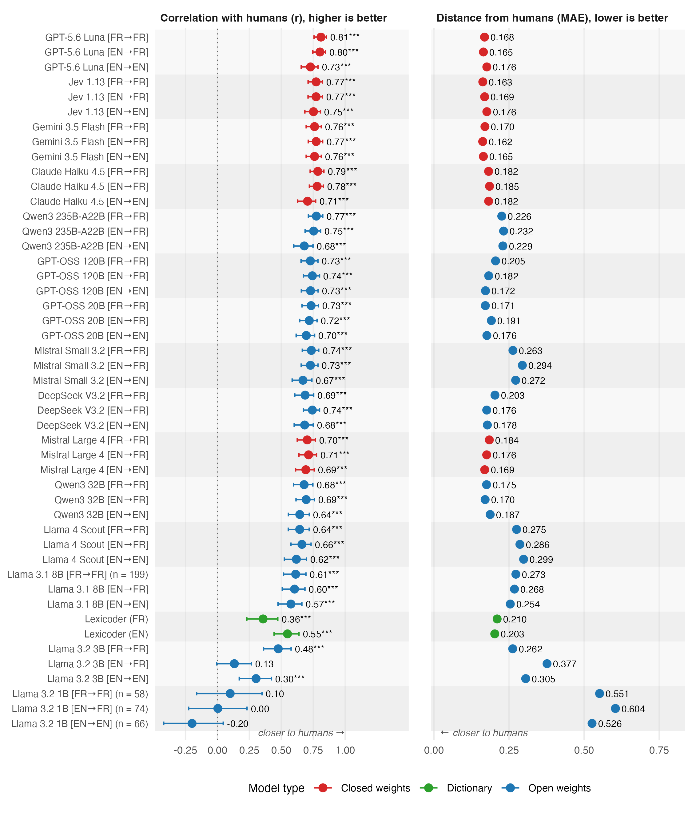
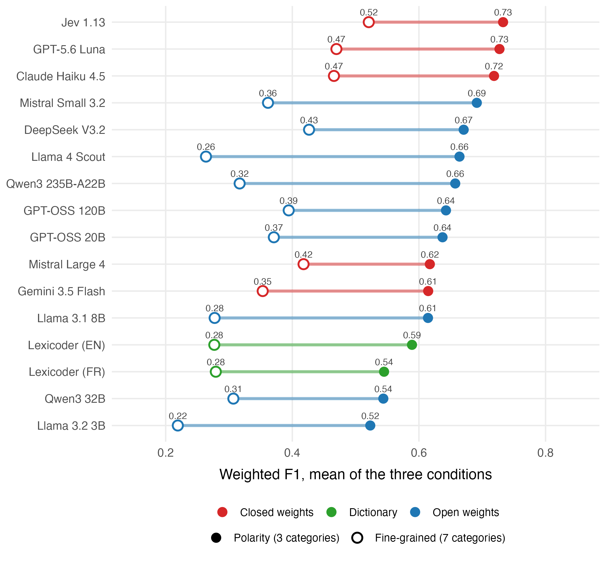
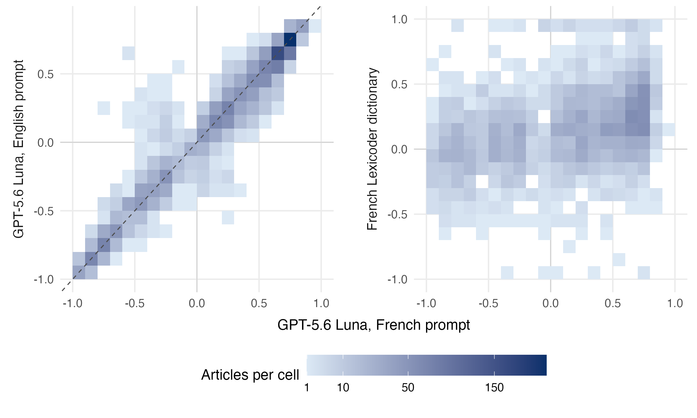

::: {#tbl-query}

| Group | Search terms |
|:-----------|:-----------------------------------------------------|
| French terms | *logiciel libre*, *logiciels libres*, *logiciel open source*, *logiciels open source*, *code source ouvert*, *code source libre* |
| English and borrowed terms | *open source*, *open-source*, *free software*, *software libre* |
| Proper names | *Free Software Foundation*, *Richard Stallman* |

Table: Search Terms Used to Select Articles in the Eureka Database

:::

::: {#tbl-source-summary}



Table: Collected Articles by Source Media

:::

::: {#tbl-prompt}

| Component | English prompt | French prompt |
|:-----------|:------------------------------------|:------------------------------------|
| Task | Please analyze the sentiment of the following French text and provide a single numerical rating according to this scale: | Veuillez analyser le sentiment du texte français suivant et fournir une évaluation numérique unique selon cette échelle : |
| Scale, -1.0 | Strong negative sentiment - highly critical, hostile, or pessimistic content | Sentiment négatif fort - contenu très critique, hostile ou pessimiste |
| Scale, -0.5 | Moderate negative sentiment - somewhat negative, disapproving, or concerned content | Sentiment négatif modéré - contenu plutôt négatif, désapprobateur ou préoccupant |
| Scale, 0.0 | Neutral sentiment - factual, balanced, or neither positive nor negative content | Sentiment neutre - contenu factuel, équilibré, ou ni positif ni négatif |
| Scale, 0.5 | Moderate positive sentiment - somewhat positive, approving, or optimistic content | Sentiment positif modéré - contenu plutôt positif, approbateur ou optimiste |
| Scale, 1.0 | Strong positive sentiment - highly supportive, enthusiastic, or optimistic content | Sentiment positif fort - contenu très favorable, enthousiaste ou optimiste |
| Intermediate values | You may also use values between these points for intermediate sentiment levels (e.g., -0.7, 0.3). | Vous pouvez également utiliser des valeurs intermédiaires entre ces points pour des niveaux de sentiment intermédiaires (par exemple, -0.7, 0.3). |
| Instruction 1 | First, carefully read and understand the text, considering cultural and linguistic nuances in French. | D'abord, lisez attentivement et comprenez le texte, en tenant compte des nuances culturelles et linguistiques en français. |
| Instruction 2 | Analyze the emotional tone, word choice, and overall message. | Analysez le ton émotionnel, le choix des mots et le message global. |
| Instruction 3 | Respond ONLY with a single numerical value between -1.0 and 1.0 that best represents the sentiment. | Répondez UNIQUEMENT avec une valeur numérique unique entre -1.0 et 1.0 qui représente le mieux le sentiment. |
| Instruction 4 | Do not include ANY explanations, analysis, or additional text in your response. | N'incluez AUCUNE explication, analyse ou texte supplémentaire dans votre réponse. |
| Input | Here is the text to analyze: [sentence] | Voici le texte à analyser : [sentence] |

Table: Wording of the English and French Prompts on French Text, by Component. Both Were Preceded by the Same English System Prompt: "You are a helpful assistant that analyzes the sentiment of text. You provide accurate and consistent sentiment ratings according to the specified scale." The English Prompt on the English Translation Differs Only in Referring to English Instead of French (Task and Instruction 1).

:::

```{=latex}
\begin{table}[p]
\caption{Correlation With Human Judgments (With 95\% Confidence Interval), Mean Absolute Error, and Number of Sentences Scored, by Model and Condition}
\begin{center}
\footnotesize
\setlength{\tabcolsep}{5pt}
\input{../../results/tables/performance_table.tex}
\end{center}
\end{table}
\clearpage
```

::: {#tbl-cost}



Table: Cost of Scoring 1,000 Sentences at List Prices (Upper Bound; Cached Prompt Tokens Counted at the Full Input Rate; Input Tokens and Cost Not Reported for Llama 3.2 1B, Whose Endpoint Returned a Constant Token Count)

:::

::: {#tbl-f1-3cat}



Table: F1 Scores for 3-Category Classification

:::

```{=latex}
\clearpage
\begin{landscape}
\begin{table}[h]
\caption{F1 Scores for 7-Category Classification}
\begin{center}
\scriptsize
\setlength{\tabcolsep}{5pt}
\renewcommand{\arraystretch}{0.95}
\input{../../results/tables/f1_scores_7cat_table.tex}
\end{center}
\end{table}
\end{landscape}
\clearpage
```

::: {#tbl-tokens}



Table: Mean Input Tokens per API Call by Language Condition, and Tokens per Word by Text Language (Valid Calls Only; Llama 3.2 1B Excluded Because Its Endpoint Reported a Constant Token Count on Every Call; Jev's Input Is a Structured Question Rather Than the Text Prompt, So Its Counts Are Not Comparable)

:::

{#fig-s-performance apa-note="One row per model and condition, sorted by each model's mean correlation and colored by model type. Left panel: Pearson correlation between the model's scores and the mean of three human coders, with 95% confidence intervals. Right panel: mean absolute error, the average distance between the model's score and the human score on the −1 to 1 scale, so that 0.17 means the model is typically 0.17 points away from the human rating. Within each model, the conditions are FR→FR (French prompt on French text), EN→FR (English prompt on French text), and EN→EN (English prompt on translated text). $^{*}p$ < .05, $^{**}p$ < .01, $^{***}p$ < .001."}

{#fig-s-f1 apa-note="One row per model, from the highest polarity F1 to the lowest, colored by model type. Filled circles are the weighted F1 on three categories, hollow circles on seven, each averaged over the three conditions; the segment is the loss from grouping sentiment into seven categories instead of three. Llama 3.2 1B is omitted."}

{#fig-s-corpus apa-note="Each cell covers a 0.1 by 0.1 range of scores and is shaded by the number of articles it contains (n = 2,671). The horizontal axis is the GPT-5.6 Luna score under the French prompt. Left: the same model's score under the English prompt, with the identity line dashed (r = 0.97; the two prompts give the same sign on 94% of articles). Right: the French Lexicoder score on the original text (r = 0.36; the dictionary and the model give the same sign on 66% of articles and opposite signs on 28%, the remainder being articles that one of the two scores exactly zero). All scores run from −1 (very negative) to 1 (very positive)."}
